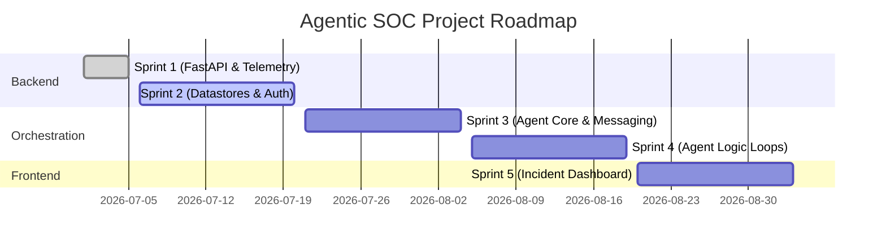

# Agentic SOC with Specialized AI Agents

An enterprise-grade Security Operations Center (SOC) platform powered by multiple specialized AI agents, developed using production-quality software engineering practices.

---

## Project Description

Modern Security Operations Centers (SOC) face an overwhelming volume of security alerts, system logs, and complex threat vectors daily. Single-chatbot generic interfaces often lack the necessary domain context, specialized tools, and reasoning depth required to resolve complex, multi-stage cyber threats.

This project implements a **Multi-Agent SOC Framework** comprising specialized AI agents (such as Log Analyzers, Network Forensics Agents, Threat Intel Refiners, and Incident Commanders). These agents work collaboratively via structured protocols to detect, analyze, triage, and mitigate security threats in real time.

---

## Objectives

- **Agent Specialization**: Deploy dedicated, role-specific AI agents equipped with custom tools rather than relying on a single general-purpose model.
- **Collaborative Forensics**: Orchestrate agents to solve complex, multi-stage security alerts using agent-to-agent negotiations and structured messaging protocols.
- **Production-Grade Engineering**: Adhere to enterprise software standards, including clean architecture, strict configuration validation, full type safety, structured logging, and unified request-scoped tracing.

---

## Current Sprint Status

### 🚀 Sprint 1 (Release Complete)
- **FastAPI Foundation**: Setup versioned API router layout (`/api/v1`).
- **Telemetry & Tracing**: Implemented request-scoped UUID tracing middleware (injecting `X-Request-ID` headers).
- **Structured Logging**: Configured unified, standard-format logging that preserves request context across execution boundaries.
- **Error Handling**: Implemented centralized, robust HTTP exception handlers and custom error wrapper schemas.
- **Release Engineering**: Prepared `.gitignore`, license definitions, and an automated startup bash script (`run.sh`).

> [!NOTE]
> *AI and Database business logic are out of scope for Sprint 1 (no databases, active agents, or security simulation rules are integrated yet).*

---

## Technology Stack

- **Runtime Environment**: Python `3.14+`
- **Web Framework**: FastAPI (ASGI-compliant)
- **Data Validation & Settings**: Pydantic v2 & Pydantic Settings
- **ASGI Web Server**: Uvicorn (leveraging standard event loop & HTTP tools)
- **Configuration Management**: Python-dotenv variables
- **Testing Infrastructure**: Pytest ready scaffolding

---

## Folder Structure

Below is the directory structure highlighting the organization of the codebase:

```text
agentic_soc/
├── backend/                  # Application Source Code
│   ├── api/                  # Unified Router Layout
│   │   ├── router.py         # Main API Router
│   │   └── v1/               # Version 1 Namespace
│   │       ├── router.py     # V1 Router Assembly
│   │       └── endpoints/    # Route Handlers
│   │           ├── health.py # System Health Checker
│   │           └── root.py   # API Root Info
│   ├── core/                 # Core Infrastructure
│   │   ├── config.py         # App Settings (Pydantic Settings)
│   │   ├── context.py        # ContextVars definitions (Request ID)
│   │   ├── exceptions.py     # Custom exceptions base class
│   │   └── logging.py        # Unified logging setup
│   ├── database/             # Database connectivity (empty skeleton)
│   ├── middleware/           # HTTP Request Middlewares
│   │   ├── errors.py         # Centralized error mapping
│   │   ├── logging_middleware.py # Request latency logger
│   │   └── request_id.py     # X-Request-ID injector
│   ├── models/               # Database ORM models (empty skeleton)
│   ├── schemas/              # Pydantic Request/Response models
│   │   └── responses.py      # Standard envelopes (Root, Health, Errors)
│   ├── services/             # Core business logic (empty skeleton)
│   └── utils/                # Helper utilities (empty skeleton)
├── configs/                  # Configurations and policy definitions
├── data/                     # Mock logs, datasets, and static files
├── deployments/              # Deployment and production orchestrations
├── docs/                     # Documentation directory
├── infrastructure/           # Cloud architecture templates (IaC)
├── scripts/                  # Administrative and helper scripts
├── security/                 # Local threat containment and security policies
├── tests/                    # Backend automated test suite
│   ├── e2e/                  # End-to-End tests
│   ├── integration/          # Integration tests
│   ├── test_data/            # Mock schemas / payloads
│   └── unit/                 # Unit tests
```

---

## Repository Structure

The key configuration and utility files in the root of the repository are:

| File / Directory | Description |
| :--- | :--- |
| `run.sh` | Main shell script entry point to check environment setup and boot the server. |
| `requirements.txt` | Defines all third-party Python package dependencies. |
| `pyproject.toml` | Standardized packaging and development configuration metadata. |
| `.env.example` | Template for environment variable settings. |
| `.gitignore` | Prevents local cache, logs, virtual environments, and configuration from being committed. |
| `LICENSE` | Full copy of the open-source MIT License terms. |

---

## Prerequisites

- **Python**: Version `3.14` or higher installed on your system.
- **Git**: For version control.

---

## Installation

### 1. Clone the Repository
Clone the codebase to your local workspace:
```bash
git clone https://github.com/qwerty123950/agentic_soc.git
cd agentic_soc
```

### 2. Configure Environment Variables
Copy the template configuration file to initialize your local `.env`:
```bash
cp .env.example .env
```
Adjust configurations in `.env` (such as `PORT`, `HOST`, or log settings) as needed.

---

## Virtual Environment

Create and activate a isolated Python virtual environment to manage dependencies locally:

```bash
# Create the virtual environment
python3 -m venv venv

# Activate the virtual environment
source venv/bin/activate
```

Once activated, install project dependencies:
```bash
pip install -r requirements.txt
```

---

## Running the Application

Start the backend application with full validation and check procedures using the provided `run.sh` script:

```bash
# Make the launcher script executable if necessary
chmod +x run.sh

# Run the launcher
./run.sh
```

---

## API Documentation URLs

Once the application is running, you can access the following resources:

| Endpoint | Purpose | URL |
| :--- | :--- | :--- |
| **System Root API** | Base metadata output | [http://127.0.0.1:8000/](http://127.0.0.1:8000/) |
| **Swagger UI Docs** | Interactive API browser | [http://127.0.0.1:8000/docs](http://127.0.0.1:8000/docs) |
| **ReDoc** | Static visual documentation | [http://127.0.0.1:8000/redoc](http://127.0.0.1:8000/redoc) |
| **OpenAPI Schema** | JSON OpenAPI description | [http://127.0.0.1:8000/openapi.json](http://127.0.0.1:8000/openapi.json) |
| **Health Check** | System status and service health | [http://127.0.0.1:8000/api/v1/health](http://127.0.0.1:8000/api/v1/health) |

---

## Project Roadmap



- **Sprint 1**: Establish backend framework foundation (FastAPI routing, structured logging, UUID tracing context, custom error mapping middleware, release automation scripts).
- **Sprint 2 (Upcoming)**: Datastore initialization (SQL/NoSQL integration), security authentication layers, mock threat telemetry stream generators.
- **Sprint 3**: Multi-agent orchestration layer, agent negotiation strategies, and state tracking.
- **Sprint 4**: Specialization coding (Log Analyzers, Network Forensics, Threat Intelligence rulesets).
- **Sprint 5**: Incident Response Web Console (frontend UI integration).

---

## Future Work

- **Telemetry Aggregation**: Integrate real-time security logs from standard collectors (e.g., Zeek log files, systemd journal records).
- **Semantic Vector Storage**: Integrate semantic embeddings with vector databases to perform fast lookup of past indicators of compromise (IOCs).
- **Human-in-the-Loop Safeguards**: Implement a secure mechanism for Incident Commanders to request human approval before executing invasive defensive actions.

---

## License

This project is licensed under the MIT License - see the [LICENSE](LICENSE) file for details.
